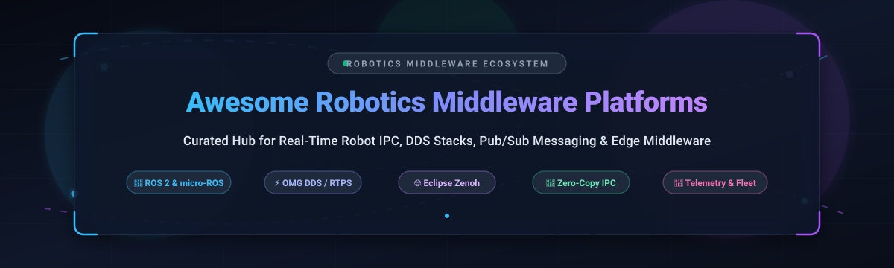

<p align="center">
  
</p>

# 🤖 Awesome Robotics Middleware Platforms ⚡

> **A curated showcase of premier SaaS platforms, enterprise frameworks, and open-source middleware powering real-time robot communication, Data Distribution Service (DDS), publish-subscribe messaging, zero-copy IPC, and autonomous edge systems.**

<p align="center">
  <a href="https://github.com/ishandutta2007/Awesome-Awesome-Awesome"></a><a href="https://discord.gg/jc4xtF58Ve"></a>
  <a href="https://github.com/ishandutta2007/Awesome-Robotics-Middleware-Platforms/stargazers"></a>
  <a href="https://github.com/ishandutta2007/Awesome-Robotics-Middleware-Platforms/network/members"></a>
  <a href="https://github.com/ishandutta2007/Awesome-Robotics-Middleware-Platforms/pulls"></a>
  <a href="https://github.com/ishandutta2007/Awesome-Robotics-Middleware-Platforms/blob/main/LICENSE"></a>
  <a href="https://github.com/ishandutta2007"></a>
</p>

---

## 📑 Table of Contents

- [🌐 Sector Overview & Market Dynamics](#-sector-overview--market-dynamics)
- [🏢 SaaS & Hosted Commercial Platforms](#-saas--hosted-commercial-platforms)
- [💻 Open-Source GitHub Projects](#-open-source-github-projects)
- [🧠 Architectural Breakdown & Comparison](#-architectural-breakdown--comparison)
- [🤝 How to Contribute](#-how-to-contribute)
- [##  Star History](#--star-history)
- [💖 Support & Sponsoring](#-support--sponsoring)
- [🛡️ Disclaimer & Safety Notice](#️-disclaimer--safety-notice)

---

## 🌐 Sector Overview & Market Dynamics

The global robotics software and middleware sector is valued at approximately **$15.5 billion in 2025** and is projected to expand to **over $48.2 billion by 2030** at an estimated CAGR of **21.5%**, with dedicated robot communication, real-time middleware, and data-routing infrastructure accounting for roughly **$2.2 billion** of this total. 

Market dynamics reflect a **moderately fragmented and hybrid-layered ecosystem** rather than a winner-take-all monopoly: community-driven open-source standards (predominantly **ROS 2**, **Eclipse Zenoh**, **Fast DDS**, and **Cyclone DDS**) command dominant developer market share in research and prototyping, while specialized commercial vendors (such as **AWS**, **MathWorks**, and **RTI Connext**) capture high-margin enterprise deployments by offering mission-critical functional safety certifications (ISO 26262, IEC 61508, DO-178C), long-term enterprise SLAs, and hosted fleet teleoperation backbones.

---

## 🏢 SaaS & Hosted Commercial Platforms

Below is a comparison of leading hosted platforms and enterprise robotics middleware providers, sorted in descending order of corporate scale (valuation / market capitalization / revenue).

| 🏷️ Product & Provider | 🏢 Company Scale (Valuation / Revenue) | 💰 Specific Starting Pricing | 🆓 Specific Free Tier / Trial Limits | 🚀 Core Capabilities & Middleware Focus |
| :--- | :--- | :--- | :--- | :--- |
| **[AWS IoT Greengrass](https://aws.amazon.com/greengrass/)**<br>*(Amazon Web Services)* | **~$1.9 Trillion** Market Cap<br>*(AWS ~$105B ARR)* | **$0.16 / active core device / month** *(flat rate for first 10,000 devices)* | **3 active core devices free every month for 12 months** under AWS Free Tier | Edge runtime bridging ROS/ROS 2 nodes to AWS cloud; enables containerized Lambda execution, MQTT communication, local broker routing, and OTA fleet updates. |
| **[MathWorks ROS Toolbox](https://www.mathworks.com/products/ros.html)**<br>*(The MathWorks, Inc.)* | **~$1.5 Billion** Annual Revenue<br>*(Private)* | **$840 / year** *(named-user commercial add-on; requires base MATLAB standard license at $940/yr)* | **30-day free trial** with full MATLAB & ROS Toolbox functionality, technical support, and cloud simulation access | MATLAB/Simulink visual middleware bridge for ROS and ROS 2; auto-generates standalone C++ ROS nodes, kinematic solvers, and software-in-the-loop (SIL) testbenches. |
| **[RTI Connext DDS](https://www.rti.com/)**<br>*(Real-Time Innovations)* | **~$70 Million** Annual Revenue<br>*(Private)* | **$3,000 / developer seat / year** *(Connext Core entry license; royalty-free target deployment)* | **30-day evaluation trial** with full developer tooling; **Free perpetual Community License** for non-commercial academic research | Flagship OMG DDS implementation deployed in 2,000+ critical autonomous designs; features formal DO-178C/ISO 26262 safety certification packages and deterministic QoS. |
| **[Foxglove](https://foxglove.dev/)**<br>*(Foxglove Technologies)* | **~$70 Million** Valuation<br>*($15M Series A raised)* | **$20 / month** *(Pro plan; includes 3 developer seats, 1 TB cloud storage, unlimited basic viewers)* | **Free forever plan** with 10 GB cloud storage, up to 3 developer seats, up to 5 connected devices, and 1 hour query runtime/month | Cloud robotics observability and telemetry middleware; indexes MCAP recordings, streams live ROS 1/ROS 2 topics over WebSockets, and renders 3D coordinate frame transforms. |
| **[ZettaScale Zenoh (Enterprise)](https://www.zettascale.tech/)**<br>*(ZettaScale Technology)* | **~$30 Million** Valuation<br>*(Backed by TTTech Auto $1.4B / ADLINK)* | **$6,000 / year** *(Enterprise Support tier with guaranteed 8x5 SLA and certified binary builds)* | **100% free forever open-source core** (Apache 2.0 / EPL 2.0) with zero node or bandwidth restrictions | Enterprise support and routing infrastructure for the Eclipse Zenoh protocol; delivers ultra-low overhead pub/sub/query routing across unstable wireless and edge topologies. |
| **[GurumDDS](https://www.gurum.co.kr/)**<br>*(GurumNetworks)* | **~$5 Million** Valuation<br>*(~$2M ARR, Private)* | **$2,500 / developer seat / year** *(Standard embedded/industrial runtime license)* | **30-day free evaluation trial** with complete multi-node ROS 2 `rmw_gurumdds` communication upon web registration | Commercial DDS implementation tailored for industrial robotic controllers and defense networks; official binary-supported RMW vendor in ROS 2 distributions. |

---

## 💻 Open-Source GitHub Projects

The premier open-source robotics middleware frameworks, publish-subscribe libraries, and zero-copy IPC transport engines, **sorted in descending order by GitHub Stars_Count**.

*Each repository entry includes a direct link to its repository and a live stargazer badge linking to its stargazer community.*

1. **[Apollo Cyber RT](https://github.com/ApolloAuto/apollo)** [](https://github.com/ApolloAuto/apollo/stargazers)  
   🏎️ High-performance runtime framework and component-based messaging middleware built specifically for autonomous driving systems. Features deterministic user-space coroutine scheduling, kernel-bypass shared-memory IPC, and adaptive queueing to eliminate latency jitter in high-frequency LIDAR/radar perception loops.

2. **[Rerun](https://github.com/rerun-io/rerun)** [](https://github.com/rerun-io/rerun/stargazers)  
   📊 Visualizer and real-time streaming SDK designed for multimodal spatial-temporal robotics data. Allows roboticists to stream images, point clouds, tensors, and robot transforms seamlessly over Apache Arrow-based IPC with nanosecond-accurate timeline scrubbing.

3. **[ZeroMQ (libzmq)](https://github.com/zeromq/libzmq)** [](https://github.com/zeromq/libzmq/stargazers)  
   ⚡ Universal asynchronous messaging library carrying message passing over inproc, IPC, TCP, TIPC, and multicast. Provides brokerless pub/sub, push/pull, and router/dealer sockets, serving as the high-throughput transport engine behind countless custom robotics communication backbones.

4. **[ROS 2 (Robot Operating System 2)](https://github.com/ros2/ros2)** [](https://github.com/ros2/ros2/stargazers)  
   🤖 The world's leading open-source robotics middleware ecosystem. Built on a decentralized DDS foundation, ROS 2 provides type-safe publish-subscribe messaging, synchronous RPC service calls, preemptible action feedback, lifecycle nodes, fine-grained Quality of Service (QoS) profiles, and an extensible ROS Middleware (RMW) abstraction layer.

5. **[NNG (nanomsg-next-gen)](https://github.com/nanomsg/nng)** [](https://github.com/nanomsg/nng/stargazers)  
   🔌 Lightweight, brokerless Scalability Protocols library written in pure C. Delivers high-reliability pub/sub, request/reply, and survey communication patterns ideal for resource-constrained micro-controllers, onboard sensors, and inter-process robot telemetry.

6. **[Dora-rs](https://github.com/dora-rs/dora)** [](https://github.com/dora-rs/dora/stargazers)  
   🦀 Dataflow-Oriented Robotic Architecture middleware written in Rust. Features ultra-fast zero-copy shared memory data exchange backed by Apache Arrow columnar memory, multi-language orchestration (Rust, Python, C, C++), and seamless bidirectional bridging to ROS 2.

7. **[Eclipse Zenoh](https://github.com/eclipse-zenoh/zenoh)** [](https://github.com/eclipse-zenoh/zenoh/stargazers)  
   🌐 Ultra-low overhead protocol that unifies data in motion, data in use, and data at rest. Delivers **~97–99% reduction in discovery overhead** compared to standard DDS, making it the premier choice for multi-robot swarms, mobile robots on lossy Wi-Fi/cellular links, and native ROS 2 RMW backends (`rmw_zenoh_cpp`).

8. **[ROS 1 Core](https://github.com/ros/ros)** [](https://github.com/ros/ros/stargazers)  
   🏛️ The foundational Robot Operating System packages that pioneered robotics modularity, centralized parameter servers, and publish/subscribe graph architecture across academic laboratories and industrial deployments worldwide.

9. **[eProsima Fast DDS](https://github.com/eProsima/Fast-DDS)** [](https://github.com/eProsima/Fast-DDS/stargazers)  
   🚀 The default ROS 2 middleware implementation (`rmw_fastrtps_cpp`). Delivers high-performance OMG DDS/RTPS compliance in C++ with sub-20μs latency, dynamic and static discovery modes, shared memory transport, and complete security specification compliance.

10. **[MAVLink](https://github.com/mavlink/mavlink)** [](https://github.com/mavlink/mavlink/stargazers)  
    🛸 Ultra-lightweight, binary serialization and messaging protocol optimized for unmanned autonomous systems (drones, rovers, and underwater submersibles). Transmits telemetry and commands reliably over constrained wireless radio links with minimal packet overhead.

11. **[Eclipse iceoryx](https://github.com/eclipse-iceoryx/iceoryx)** [](https://github.com/eclipse-iceoryx/iceoryx/stargazers)  
    ❄️ True zero-copy inter-process communication (IPC) middleware based on shared memory. Guarantees deterministic, sub-microsecond latency regardless of payload size—enabling continuous gigabyte-scale transfers of raw uncompressed point clouds and 4K camera frames between autonomous nodes.

12. **[Eclipse Cyclone DDS](https://github.com/eclipse-cyclonedds/cyclonedds)** [](https://github.com/eclipse-cyclonedds/cyclonedds/stargazers)  
    🌪️ High-throughput, ultra-low delay OMG DDS implementation in C. Widely favored in ROS 2 deployments (`rmw_cyclonedds_cpp`) for its compact memory footprint, deterministic packet routing, and rigorous conformance to real-time distributed specifications.

13. **[LCM (Lightweight Communications and Marshalling)](https://github.com/lcm-proj/lcm)** [](https://github.com/lcm-proj/lcm/stargazers)  
    🛰️ Low-latency message-passing and data-marshalling library engineered for high-bandwidth robotics research. Leverages UDP multicast without centralized brokers and provides instantaneous traffic logging, playback, and packet inspection utilities.

14. **[MCAP](https://github.com/foxglove/mcap)** [](https://github.com/foxglove/mcap/stargazers)  
    📦 Modular, high-performance serialization-agnostic file format designed for recording heterogeneous robotics telemetry, ROS 1/2 bags, Protobuf channels, and JSON log streams without external schema dependencies.

15. **[YARP (Yet Another Robot Platform)](https://github.com/robotology/yarp)** [](https://github.com/robotology/yarp/stargazers)  
    🤖 Middleware and device abstraction layer developed by the Italian Institute of Technology (IIT). Serves as the software nervous system for complex humanoids such as the iCub, managing motor control loops, visual tracking, and multi-threaded device drivers.

16. **[micro-ROS](https://github.com/micro-ROS/micro_ros_setup)** [](https://github.com/micro-ROS/micro_ros_setup/stargazers)  
    🔬 Extends ROS 2 seamlessly onto resource-constrained microcontrollers (STM32, ESP32, Teensy, Raspberry Pi Pico). Runs an optimized Client-Agent architecture over UART, USB, or Ethernet with static memory allocation and POSIX-compliant RTOS support.

17. **[HORUS Robotics](https://github.com/softmata/horus)** [](https://github.com/softmata/horus/stargazers)  
    ⚡ Ultra-low latency robotics runtime system built in Rust with Python bindings. Achieves **87ns IPC latency and 12M+ messages/second throughput** using zero-copy shared memory, type-safe schema validation, and real-time deadline-driven thread scheduling.

18. **[Eclipse Zenoh-Pico](https://github.com/eclipse-zenoh/zenoh-pico)** [](https://github.com/eclipse-zenoh/zenoh-pico/stargazers)  
    📟 Ultra-compact pure-C client implementation of Zenoh crafted for deeply embedded microcontrollers, edge sensors, and battery-powered IoT robotic accessories with strict RAM/ROM budgets.

19. **[eProsima Micro-XRCE-DDS](https://github.com/eProsima/Micro-XRCE-DDS)** [](https://github.com/eProsima/Micro-XRCE-DDS/stargazers)  
    📡 Implementation of the OMG DDS-XRCE standard allowing microcontrollers to act as first-class citizens in DDS domains via an intermediate Agent gateway, forming the communication backbone of micro-ROS.

20. **[Orocos RTT (Real-Time Toolkit)](https://github.com/orocos-toolchain/rtt)** [](https://github.com/orocos-toolchain/rtt/stargazers)  
    ⏱️ C++ component framework for deterministic, hard real-time robot motion and joint torque control. Provides lock-free port buffers, state-machine execution engines, and seamless RTOS integration (Xenomai, Linux PREEMPT_RT).

21. **[Wrapyfi](https://github.com/modular-ml/wrapyfi)** [](https://github.com/modular-ml/wrapyfi/stargazers)  
    🐍 Flexible Python decorator-based wrapper that unifies message-oriented middleware across ROS, ROS 2, YARP, ZeroMQ, and MQTT. Eliminates glue code when deploying deep learning models onto heterogeneous robot stacks.

22. **[Open-RAIL](https://github.com/CMCC-TAO/open-rail)** [](https://github.com/CMCC-TAO/open-rail/stargazers)  
    🧠 Open-source middleware connecting Vision-Language-Action (VLA) foundation models and World-Action Models (WAM) to physical robotic arms and chassis via a three-threaded asynchronous observation-inference-control pipeline.

23. **[ZRM (Zenoh ROS-like Middleware)](https://github.com/JafarAbdi/zrm)** [](https://github.com/JafarAbdi/zrm/stargazers)  
    🛠️ Clean, single-file communication middleware built atop Zenoh. Adopts familiar ROS 2 communication paradigms (Topics, Services, Links) with Protobuf runtime validation and quick CLI inspection commands.

24. **[SONNY OS](https://github.com/JackTrainer/Sonny)** [](https://github.com/JackTrainer/Sonny/stargazers)  
    🦾 Agnostic microkernel for robots built in Rust and Zenoh. Provides a sandboxed WebAssembly execution layer, a JSON-based hardware abstraction layer (HAL), and sub-millisecond watchdog jitter supervision.

---

## 🧠 Architectural Breakdown & Comparison

Robotics communication architectures differ widely based on reliability constraints, transport medium, payload scale, and execution deadlines:

```mermaid
flowchart TD
    subgraph Sensoractuator["Onboard Real-Time Compute"]
        A["Hardware Devices / Cameras / LIDARs"] -->|Raw Shm Buffers| B["Zero-Copy Shared Memory (iceoryx / HORUS)"]
        B -->|Sub-microsecond IPC| C["Perception & Local Motion Planners"]
    end

    subgraph NodeGraph["Distributed Node Mesh"]
        C <-->|OMG DDS / RTPS (Fast DDS, Cyclone DDS)| D["ROS 2 Node Graph"]
        D <-->|XRCE Client Protocol| E["Embedded MCUs (micro-ROS / XRCE-DDS)"]
    end

    subgraph FieldEdge["Wireless & Multi-Robot Edge"]
        D <-->|Lightweight Pub/Sub/Query| F["Eclipse Zenoh Router"]
        F <-->|Lossy Wi-Fi / 5G / Satellite| G["Multi-Robot Swarm & Remote Teleoperation"]
    end

    subgraph CloudTelemetry["Enterprise Cloud Fleet"]
        F -->|Secure TLS WebSocket / MQTT| H["Cloud Middleware & Observability (Foxglove / AWS Greengrass)"]
    end
```

### 📋 Technology Comparison Matrix

| Middleware Category | Primary Implementations | Typical Latency | Network Topology | Best Use Cases |
| :--- | :--- | :--- | :--- | :--- |
| **OMG DDS / RTPS** | Fast DDS, Cyclone DDS, RTI Connext | 15–50 μs | Decentralized Peer-to-Peer | Standardized intra-vehicle sensor fusion, ROS 2 default graphs, safety-critical deterministic controllers. |
| **Data-Centric Edge (Zenoh)** | Eclipse Zenoh, Zenoh-Pico | 50–150 μs | Peer-to-Peer, Routed or Brokered | Wireless/cellular multi-robot swarms, mobile AMRs, resource-constrained telemetry bridges. |
| **Zero-Copy Shared Memory** | Eclipse iceoryx, HORUS, Dora-rs | 0.08–1.5 μs | Local IPC (Shared POSIX / Memory Maps) | High-bandwidth 4K video feeds, point clouds, large VLA model tensor pipelines on single compute hosts. |
| **Brokerless Messaging** | ZeroMQ, NNG, LCM | 20–100 μs | Point-to-Point / Multicast | Custom laboratory setups, lightweight research testbeds, modular microservice decoupling. |
| **Microcontroller Extensions** | micro-ROS, Micro-XRCE-DDS | 100–500 μs | Client-Agent Gateway | Hard real-time sensor/actuator nodes running FreeRTOS/Zephyr on microcontrollers. |

---

## 🤝 How to Contribute

Contributions, project suggestions, and documentation enhancements are enthusiastically welcome!

1. 🍴 **Fork the repository** on GitHub.
2. 🌿 **Create a descriptive feature branch**:
   ```bash
   git checkout -b add/my-middleware-platform
   ```
3. 📝 **Add or edit entries in `README.md`**:
   - Maintain accurate tabular details for SaaS products (specific pricing, free limits, company scale).
   - For open-source projects, include the proper stargazer badge linked to stargazers and insert the entry into the proper star-sorted position.
4. 🚀 **Commit your changes**:
   ```bash
   git commit -m "Add: New robotics middleware platform"
   ```
5. 📤 **Push to your branch and submit a Pull Request** with a clear explanation of your addition.

---

##  Star History
[](https://star-history.dera.page/#ishandutta2007/Awesome-Robotics-Middleware-Platforms&type=date&legend=top-left)

---

## 💖 Support & Sponsoring

Thank you for visiting and supporting **Awesome Robotics Middleware Platforms**! 🤖✨

If this curated repository helps you choose the right communication stack, speeds up your robotics development, or informs your autonomous systems architecture, please consider supporting the project:

- ⭐ **Star this repository** to help fellow roboticists find it
- 🍴 **Fork the project** and contribute additions or corrections
- 📢 **Share with the community** on ROS Discourse, LinkedIn, X, and robotics forums
- ☕ **Support the maintainer**: Buy a coffee or sponsor maintenance via the [GitHub Sponsor Dashboard](https://github.com/sponsors/ishandutta2007)

<p align="left">
  <a href="https://github.com/sponsors/ishandutta2007"></a>
</p>

---

## 🛡️ Disclaimer & Safety Notice

- This repository is a **community-curated index** created for educational, research, and architectural evaluation purposes.
- Robotics middleware platforms frequently control physical actuators, heavy machinery, autonomous vehicles, and medical robots. Always validate network Quality of Service (QoS), deterministic latency boundaries, watchdog timeouts, and fail-safe safety interlocks in simulation before testing on physical hardware.
- Ensure that commercial deployments adhere to regulatory standards applicable to your jurisdiction (e.g., ISO 26262 for automotive, IEC 61508 for industrial, or DO-178C for avionics).
